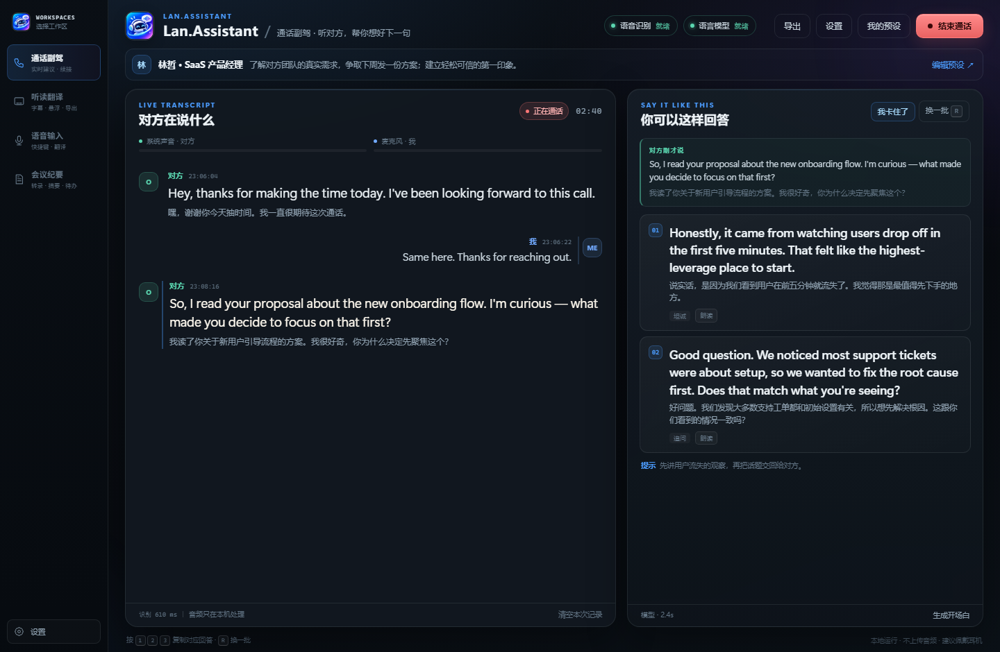

# Lan.Assistant

当前版本：**v1.0**（版本号统一维护在 `version.py`）

界面支持 **中文 / English / 日本語 / 한국어**。首次启动按 Windows 系统界面语言选择，不支持的语言默认英文；切换界面语言时会同步各功能的默认识别/翻译语言。

Lan.Assistant 是运行在 Windows 电脑上的实时语音助手：既能做通话副驾，也能做看剧/看视频时的双语字幕。它从「系统声音」里听对方或视频的声音，从麦克风听你说话，实时转写并用本地或 API 大模型生成回答或中文字幕。

**音频只在本机处理，不上传、不保存录音。** 默认的本地模式连文字也不上传；如果主动切换到 DeepSeek 等 API，只有对话文字会发给你选择的服务商。



---

## 现在就能用（托盘版）

1. 双击桌面「Lan.Assistant」快捷方式。**不会再弹出 Python 控制台窗口**，服务会启动到右下角系统托盘。
2. 右键托盘图标：
   - **当前功能 / 切换功能**：通话副驾、听读翻译、语音输入、会议纪要（子菜单切换）
   - **功能操作**：随当前功能变化
     - 通话副驾：开始/结束通话、生成开场白或换一批回答
     - 听读翻译：开始/结束听读、显示/隐藏悬浮字幕
     - 语音输入：开始语音输入 / 结束录音并识别 / 取消当前语音输入
     - 会议纪要：开始/结束会议、生成会议纪要
   - **打开页面**：打开主界面；如果已经有窗口，只会聚焦，不会重复打开
   - **设置**：在已有窗口里直接打开设置；没有窗口时才新建
   - **退出**：关闭副驾并卸载本地模型，释放显存
3. 第一次打开页面会弹出「我的预设」，尽量填详细，尤其是 **这次通话的目的**、**对方是谁**、**可以提到的关键事实**。**填写后会自动保存到本机**，不用每次重写。
4. 在左侧工作区栏选择功能：
   - **通话副驾**：系统声音 + 麦克风，回答语言跟随对方，附中文翻译
   - **听读翻译**：只采集系统声音，不给回答，只生成原文 + 中文字幕
   - **语音输入**：全局快捷键录音，校对后插入任意输入框
   - **会议纪要**：双声道转录，停止后自动生成纪要
5. 点右上角 **开始通话 / 开始听读 / 开始记录**。

第一次启动需要把语音识别模型和语言模型加载进显存，通常 **10–60 秒**。托盘图标出现、页面右上角两个状态灯变成绿色「就绪」后即可使用。

托盘模式下日志写在 `data/server.log`；如果托盘图标没有出现，先看这个文件。

---

## 工作区与分功能设置

左侧工作区栏：

- **通话副驾**、**听读翻译**、**语音输入**、**会议纪要**

设置分成两组：

- **全局设置**：运行环境、音频设备、识别模型、保存记录、启动恢复工作区
- **模型设置**：语音识别模型、语言模型服务、说话人区分模型，以及三类本地模型文件管理，对所有工作区生效
- **功能设置**：通话副驾、听读翻译、语音输入、会议纪要各自的选项

每个功能只显示自己的设置；识别语言也是分开的（通话、字幕、会议、语音输入各自独立）。音频设备、识别模型和模型提供商在全局设置里。托盘右键会显示**当前功能**，并可以直接切换工作区；也可以从托盘开始/结束语音输入。

## 首次启动（安装包预置）

以后的安装包只包含程序，不包含 Ollama 和模型。首次启动会进入设置页：

1. 自动下载便携版 Ollama 到 `%LOCALAPPDATA%\Lan.Assistant\ollama`（不需要管理员权限）
2. 根据当前电脑自动勾选一个推荐 Whisper 和一个推荐 Qwen 模型
3. 允许手动勾选其它模型
4. 下载完成后才启动语音识别、语言模型和主界面

模型下载到 `models/`；如果安装目录不可写，会使用 `%LOCALAPPDATA%\Lan.Assistant\models`。已经装好 Ollama 和模型的本机升级不会重新进入首次设置。

## 通话副驾

系统声音（对方）+ 麦克风（你），对方说完后给 2 条回答和中文翻译。**回答语言跟随对方**：对方说英语就回英语，说日语就回日语，说韩语就回韩语；中文翻译始终保留。适合微信语音、Zoom、Teams 等通话。

通话副驾现在会：

- 合并连续短停顿产生的「我」片段，避免一次回答被切成很多条
- 支持 **通话场景词库**（公司、项目、技术术语；`错词=正确词`）
- 停止后自动生成 **通话总结**：问答复盘、更自然的说法、可复习短语、自我介绍复盘；可手动重新生成或导出 Markdown
- 被问到时提供完整的 1–2 分钟自我介绍，并默认按 90 秒组织；也可以手动切换「我卡住了」建议

## 听读翻译

系统声音（对方）进入后自动切句并生成双语字幕。悬浮字幕现在会先显示**稳定前缀**：说话过程中约每 0.8 秒刷新英文原文，并同步生成中文草译；整句结束后用 Whisper 最终识别校正原文、替换成最终中文译文。听读模式的长段落在 6 秒左右强制切句。最终识别会优先于实时试译，避免连续说话时 final 被 partial 占住识别模型。

语速较快时字幕会**向上叠加最近 3 句**，最新一句在底部，不会因为下一句出现就把上一句顶掉；当前句仍然实时刷新。悬浮层高度已加大，以便同时看清多行。旧字幕会按长度自动老化，通常保留约 2.2–5.5 秒，长句多留、短句少留，过期后自动消失。

源语言默认自动检测，目标语言跟随界面语言；也可以手动指定。
只采集系统声音，不启用麦克风，不生成回答；适合看剧、看视频、听播客。界面会变成全宽字幕：

- 上：原文
- 下：中文翻译
- 顶部可切换 **英语 / 日语 / 韩语 / 自动检测**
- 会自动弹出 **悬浮字幕**，固定在屏幕底部、播放器上方
- **只显示文字，没有黑色底条**，不会挡住画面；文字带细黑边，亮场景也能看清
- **没有字幕时完全隐藏**；停止听读时隐藏
- 它是原生置顶文字层，点击会穿透，不会挡住播放器操作
- 可在页面右上角「悬浮字幕」按钮或托盘菜单里手动开关
- **开关状态会保存**，下次启动、切换回听读翻译时自动恢复上次状态
- 多屏时悬浮字幕默认出现在**主屏**底部；看剧在副屏时可以先把主屏设为播放器所在屏，或后续改成跟随当前窗口

悬浮字幕的适用范围：浏览器全屏、VLC/PotPlayer 等普通全屏播放器通常可以覆盖；**独占全屏游戏**或部分受保护视频可能覆盖不了。

工作区在页面左侧切换，选择会记住；切换时会停止当前采集并清空当前字幕。

## 语音输入（快捷键 / 自动焦点）

默认 **Ctrl + Alt + Space**，可在 **设置 → 语音输入** 改成 Ctrl+Shift+Space、Alt+Space、F9 或 F10。

快捷键行为有两种：

- **切换**：按一下开始，再按一下结束（默认）
- **按住说话**：按下开始，松开结束。使用低级键盘钩子监听松开，触发键不会输入到当前应用；即使不松开，到达最长录音时间也会结束。

录音开始和结束会各播放一声很轻的提示音：开始是较高的“滴”，结束是较低的“嘟”。可以在 **设置 → 语音输入 → 录音提示音** 关闭；默认开启，不影响麦克风、识别或插入。

触发方式有三种：

- **只用快捷键**：任意应用按快捷键开始，再按一次结束。
- **自动监听输入框**：只在「语音输入」工作区生效。焦点进入常见输入框时自动开始录音，停顿约 1.2 秒后自动结束；关闭校对浮窗时识别完直接插入，开启浮窗时仍会弹出校对。Electron/网页输入框（如 DSH、VS Code、Cursor）可在设置的「监听兼容窗口标题」里填多个窗口标题关键字，每行一个或用逗号分隔，默认 `DeepSeek Harness`。
- **快捷键 + 自动监听**：两种都可用。

> 兼容标题是按窗口触发的，无法区分窗口内是否真的在输入框里；如果只是阅读页面也触发了，切换到快捷键模式，或从兼容列表移除该标题。

输入语言默认 **中文（简体）**，可在设置里改成 English / 日本語 / 한국어 / 粤语 / 自动检测。默认目标语言也是中文；如果输入和目标是同一种语言，不会重复翻译。

会议纪要的识别语言默认是 **中文**，适合中文会议；英文会议可在会议设置里改成 English。

听读翻译支持选择字幕的 **目标语言**：中文、English、日本語、한국어。源语言在「字幕识别语言」里设置。

方言支持范围：

- **普通话**：支持
- **粤语**：Whisper 有 `yue` 语言代码，已增加「粤语（实验性）」选项；实际准确率取决于口音和模型
- **四川话、上海话、闽南语、客家话等其他方言**：目前没有独立选项，使用「中文」或「自动检测」时只能尽力识别，准确率不保证
- 英语、日语、韩语的地方口音没有单独设置，由 Whisper 直接识别；不需要为口音切换语言

如果需要稳定支持其他方言，需要接入专门的方言 ASR 模型（例如 FunASR / SenseVoice 一类），不是给 Whisper 换一个语言代码就能解决。

**自动补标点** 默认开启：Whisper 没给出结尾标点时补「。」或「.」，中文里的 ASCII 逗号/问号/感叹号会转成中文标点；不会改写句子内容，也不会凭空插入逗号。

**自动文字校对** 默认开启：识别后会调用当前全局模型，只修正明显的同音字、错别字、标点和英文大小写，不翻译、不改写原意、不补充内容。它会增加一次模型生成时间；如果使用 API 模型，识别文字会发送给对应 API。使用「不翻译，只转写」时同样生效。校对结果会显示在校对浮窗里，浮窗会提示「已自动校对」。

**语音词库**（可选）：一行一个词，`错词=正确词` 表示别名。规范词会作为 Whisper 的轻量提示，并进入自动校对提示；别名会在识别后按精确匹配替换。建议只放人名、公司/产品名、术语和反复出错的词，最多约 100 条，避免普通词干扰识别。

校对浮窗可以关闭。关闭后不再需要点「插入」，识别完成会直接把原文或译文写入刚才的输入框。

关闭浮窗时可在 **设置 → 语音输入 → 关闭浮窗时插入** 选择：

- **译文**（默认）：插入目标语言译文；如果没有译文则回退原文
- **原文**：始终插入识别原文

如果输入和目标是同一种语言，通常没有译文，会自动插入原文。

游戏场景：

- 默认勾选 **启动时恢复上次工作区**；可选 **开机自动启动**，登录 Windows 后自动启动托盘。
- 默认勾选 **全屏时不自动监听**。全屏游戏、全屏视频不会因为焦点变化误开麦克风。
- 游戏内自绘的聊天框通常不是标准输入框，自动焦点模式不会识别；需要时用快捷键。
- 游戏里快捷键没反应时，把 **快捷键行为** 从“按住说话”改成“按一下开始，再按一下结束”；按住说话依赖低层键盘钩子，部分反作弊/独占全屏会拦截。
- 原神这类游戏请优先用 **窗口化 / 无边框全屏**，并在按快捷键前先打开游戏聊天输入框。
- 如果游戏拒绝文字插入，校对浮窗里的内容不会丢：点 **复制**，或插入失败时自动复制，然后在游戏聊天框按 `Ctrl+V`。
- 独占全屏游戏可能拦截快捷键、低层键盘钩子或拒绝合成输入；管理员权限窗口也可能有同样问题。
- **原神等以管理员权限运行的游戏**：Lan.Assistant 也必须用管理员身份启动，否则 Windows UIPI 会阻止低权限进程接收全局快捷键或向高权限游戏发送输入。右键 `start.bat` → **以管理员身份运行**。
- 这是 Windows/游戏本身的限制，不是麦克风问题。可以先用记事本验证快捷键和麦克风是否正常。
- 游戏里也建议关闭校对浮窗，减少遮挡；但要在游戏里复制文字时需要保留浮窗。

实现方式：

- 不覆盖剪贴板，使用 `SendInput` 直接输入 Unicode。
- 会记住按下快捷键/进入输入框时最前面的窗口，插入前恢复焦点。
- 只使用麦克风，不采集系统声音；通话/会议正在采集时会拒绝语音输入。
- 管理员权限窗口、部分游戏/受保护窗口可能拒绝接收输入。
- 浮窗只在校对时出现，录音时是不抢焦点的顶部状态条。

## 会议纪要

1. 切到 **会议纪要**，点 **开始记录**。
2. 系统声音标为「会议」，麦克风标为「我」，两边分别转写。
3. 停止后自动生成，也可以随时点 **生成纪要**。
4. 右侧会显示：摘要、关键讨论、已确认决定、待办事项、未解决问题。
5. 底部 **导出 Markdown**；生成的纪要也会写入本次会话记录。
6. 设置里可以选纪要语言（中文/English）、是否停止后自动生成、填写会议背景/参会人/关注点。

说明：

- 默认只有双声道，不能区分会议里的多个发言人；多人会议统一标为「对方」。
- 可在 **会议纪要 → 与会人区分** 打开离线说话人区分；开启前需要先在 **模型设置 → 本地模型选择** 下载模型。
- 长会议会自动分段摘要再汇总。
- 不会编造未出现的负责人、日期或决定；未说明的字段显示「待定」。
- 转录内容会发送给当前选择的全局模型（本地或 API）。

### 与会人区分

- 默认且当前适配的模型：**WeSpeaker ResNet34**（跨语种，适合中英日混合）
- 模型不随程序打包；第一次使用需要下载 **pyannote 分割模型 + WeSpeaker 声纹模型**
- 停止会议后在本机离线处理，只把会议期间的系统声音片段保留在内存，处理完成即释放
- 输出匿名标签 **Speaker 1 / Speaker 2 / …**，不会自动猜真实姓名
- 首次使用或短会议会增加一段等待；CPU 也能运行，核显不会被强制使用
- 会议纪要和导出内容会带上说话人标签；识别错了可以在字幕/转录里人工改名或忽略
- 多人抢话、笑声、音色相近时仍会出错，不能保证 100% 准确

参考模型：

- [sherpa-onnx 说话人分离模型](https://github.com/k2-fsa/sherpa/blob/master/docs/source/onnx/speaker-diarization/models.rst)
- WeSpeaker ResNet34：CC-BY-4.0

源码运行时需要安装：

```powershell
.\.venv\Scripts\python.exe -m pip install "sherpa-onnx>=1.12,<2" "onnx>=1.16,<2"
```

模型下载到 `models/diarization/`；安装包和 Git 都不包含这些权重。


## 换电脑 / 硬件自动适配

启动时会自动检测：

- CPU 型号、核心/线程、内存
- NVIDIA / AMD / Intel 显卡
- 是否能用 CUDA、Vulkan 核显或只能 CPU

检测逻辑在 `hardware.py`，结果会显示在 **设置 → 通用 → 运行环境**。

默认会自动选择：

| 硬件 | 本地模型运行方式 | 语音识别 |
|---|---|---|
| NVIDIA 独显 | CUDA | CUDA float16 |
| AMD 核显 / 显卡 | Vulkan（`OLLAMA_IGPU_ENABLE=1`） | CPU int8 |
| Intel 核显 / 显卡 | Vulkan（`OLLAMA_IGPU_ENABLE=1`） | CPU int8 |
| 无可用 GPU | CPU | CPU int8 |

同时会把本地模型切到更适合的版本（NVIDIA 用 Qwen3.5-9B，其他平台用 Qwen2.5-7B）。**API 提供商、API Key 和语音输入设置不会被改动。**

硬件配置变了才会自动重新应用；同一台机器上手动改过的 `asr_device`、模型等不会被每次启动覆盖。也可以手动点「重新检测并应用」。

命令行工具：

```powershell
# 只看检测结果
.\detect_hardware.bat

# 按当前硬件重新应用推荐配置
.\apply_hardware.bat
```

注意：

- Intel / AMD 核显走 Ollama Vulkan，属于尽力启用；如果 `ollama ps` 仍显示 `100% CPU`，就用 CPU 方案。
- 核显和 CPU 共享 DDR5 内存，建议 32GB 双通道；16GB 也能跑 7B，但同时开浏览器/会议软件会比较紧。
- 换硬件后如果应用启动时旧的 Ollama 还在运行，先 `stop.bat` 再启动，让新的环境变量生效。
- 语音识别在非 NVIDIA 平台上固定走 CPU int8；不会尝试 CUDA。

## 本地模型自动发现

不需要把模型写死在程序里。启动和打开设置时会扫描：

- `models/faster-whisper-*`：Whisper 模型目录，必须有 `model.bin` 和 `config.json`
- `models/llm/*.gguf`：Qwen / 其他 GGUF 模型

设置里会直接列出发现的模型和文件大小，也可以点 **刷新模型列表**。

### 模型管理

设置 → 模型设置 → 模型管理会按三类显示：

- **语音识别模型**（Whisper）
- **语言模型**（Qwen GGUF）
- **说话人区分模型**（pyannote 分割 + WeSpeaker 声纹）

每条显示模型类型、文件路径、大小和下载状态。预设模型可以直接在行内**下载或删除**；已下载的删除按钮会移除磁盘文件，不能撤销。

自定义模型仍然手动导入：

- LLM 必须是位于 `models/llm` 下的 `.gguf` 文件
- Whisper 必须是包含 `model.bin` 和 `config.json` 的 faster-whisper 目录
- 文件不存在、扩展名不对或目录结构不完整时不会加入列表
- 自定义模型只显示在管理列表里，不提供下载/删除按钮；需要自己管理文件

整个 `models/` 目录的实际占用（包含 Ollama 的 blob）也会显示。删除语言模型时会同时尝试从 Ollama 移除同名模型。

自动选择规则：

- NVIDIA：优先 9B 大模型 + large-v3-turbo
- Intel / AMD 核显、CPU：优先最小的可用 Qwen（3B / 4B / 7B）+ Small / Base Whisper
- 16GB 以下内存更偏向 3B/4B

第一次选用一个新的 GGUF 时，程序会自动用 `ollama create` 注册它；小于 100MB 的文件会被视为不完整并忽略。

当前已经额外下载：

- `faster-whisper-small`（461 MB）
- `faster-whisper-base`（138 MB）
- `Qwen2.5-3B-Instruct-Q4_K_M.gguf`（2.0 GB）
- `Qwen2.5-1.5B-Instruct-Q4_K_M.gguf`（1.0 GB）
- `Qwen3.5-4B-Q4_K_M.gguf`（2.6 GB）
- `Qwen3.5-2B-Q4_K_M.gguf`（1.2 GB）

Intel / AMD 核显或纯 CPU 平台会自动推荐 **small + Qwen2.5-3B**；当前 NVIDIA 机器仍保持 **large-v3-turbo + Qwen3.5-9B**。

详细目录格式见 [`models/README.md`](models/README.md)。

## 支持哪些语言

- **识别源语言**：英语、日语、韩语，或「自动检测」（Whisper 支持的其他语言）。
- **语音输入**：默认中文（简体），可切英语 / 日语 / 韩语 / 自动检测；中国大陆环境默认就是中文。
- **通话回答**：跟随对方语言（英语→英语，日语→日语，韩语→韩语；自动检测时用检测到的语言）。
- **字幕 / 回答翻译**：统一翻译成简体中文。
- 默认是英语；看日剧/韩剧时在设置里把「识别语言」换成日语/韩语，或选自动检测。
- 语言在下一句识别时生效，不需要重启服务。

## 字幕预设（按剧集调整翻译）

打开 **设置 → 字幕预设**，可以针对当前在看的剧集/电影/动漫填写。修改后会自动保存到本机，不需要额外点保存。

| 字段 | 作用 |
|---|---|
| 内容类型 | 自动识别 / 电视剧 / 电影 / 动漫 / 纪录片 / 其他，影响翻译语气；自动模式由翻译模型根据剧名和上下文自行判断 |
| 剧名 / 节目名 | 给识别和翻译提供专有名词上下文 |
| 剧情、角色名、术语和翻译偏好 | 角色名、世界观、术语、语气；也支持术语表 |
| 字幕翻译风格 | 自然口语 / 贴近原文 / 保留术语 |
| 字幕停顿 | 0.25–0.65 秒，越短越快 |
| 延迟参数 | partial 刷新间隔/窗口、最长切句、悬浮轮询、翻译启动延迟、翻译上下文条数，均可手动调整 |
| 自动显示悬浮字幕 | 关闭后不会自动显示覆盖字幕 |

术语表可以直接写在上下文里，支持这些写法：

```text
Nen = 念
Nen 统一翻译为“念”
Nen -> 念
```

程序会：

1. 把剧名/术语作为 Whisper 的识别提示；
2. 把识别结果里发音相近的误听（如 `NAN`）纠正为术语名（`Nen`）；
3. 把术语表和剧集背景交给翻译模型，保证人名、招式名、专有名词前后一致。

一个例子：看《Hunter × Hunter》时填剧名，上下文写「角色名：小杰、奇犽；Nen 统一翻译为“念”；保持少年漫语气」，字幕会稳定把 `Nen` 翻成“念”，而不是“纳米技术”。

预设是当前生效的一套；换剧时改一下即可，不需要重启。

---

## 现在用的是什么模型

| 环节 | 当前实现 | 说明 |
|---|---|---|
| 语音识别 | faster-whisper **large-v3-turbo**，CUDA float16 | 多语言模型，本机跑；失败自动回退 CPU int8 |
| 断句 / VAD | **Silero VAD**（ONNX，CPU） | 通话默认 0.75 秒停顿；字幕模式默认 0.35 秒，可在设置里调低到 0.25 秒 |
| 回答 / 翻译 | 本地 **Qwen3.5-9B Q4_K_M**（Ollama，非思考模式） | 2026 年的新 9B 档，比 Qwen2.5-7B 明显更会聊天；显存约 5.7 GB；旧 Qwen2.5-7B 保留作备用 |
| 可选 API | **DeepSeek `deepseek-flash`**（V4.1 Flash）或 `deepseek-v4-pro` | 官方 API 默认开启思考；本程序发送 `thinking: {"type":"disabled"}` 关闭；JSON 输出、1M 上下文 |

### 延迟实测

在这台机器（i9-14900HX + RTX 4090 Laptop 16 GB）上：

- 语音识别：一句 3–12 秒的语音，**约 0.15–1.5 秒**。
- 本地回答：普通 2 条建议 **约 2.5–4 秒**；短自我介绍 **约 4 秒**；2 分钟长稿 **约 6–9 秒**（含长度校正）。
- 听读字幕：字幕模式默认 **0.35 秒停顿 + beam 1 + 0.08 秒翻译防抖**；实测一句结束后约 **0.5–0.8 秒**出现中文译文，端到端（含切句）约 **1 秒左右**。
- 悬浮字幕默认每 **0.15 秒**拉取一次轻量字幕接口，可在设置里调到 100ms。
- 冷启动：模型已缓存时约 **10 秒**，首次加载最长约 60 秒。

### 想要更好 / 更快

- **最明显的质量升级：接 DeepSeek API。** 设置里切换后，1 条回答通常 **1–2 秒**，2 条 **2–3 秒**，措辞明显好于本地 9B。
- **字幕再快一点**：设置 → 听读翻译，把字幕停顿降到 **0.25–0.35 秒**、partial 间隔降到 **0.5 秒**；代价是句子可能切得更碎、GPU 负载更高。
- **更快的语音识别**：可换 `distil-large-v3`（仅英文，约快 1.5–2 倍，准确率接近）。当前没有预装。
- **更准的语音识别**：可换 `large-v3`（约 3 GB），但会更慢；日常通话不建议。
- **更大的本地模型**：14B/32B 在 16 GB 笔记本显存上会很慢甚至放不下，不建议；要质量优先就用 API。

---

## 接入 DeepSeek（关闭深度思考）

1. 打开 **设置 → 模型设置 → 语言模型服务**，选择 **DeepSeek 官方 API（专用，deepseek-flash）**。
2. 地址和模型已经预填好：
   - API 地址：`https://api.deepseek.com`
   - 模型名：`deepseek-flash`（最新 V4.1 Flash；也可以填 `deepseek-v4-pro`）
   - 只需要填 API Key：你自己的 `sk-...`
   - 卡片上有「获取 API Key」链接和「恢复默认」按钮。
3. 「关闭深度思考」默认勾选，保存后点「测试模型」。
4. 点「测试模型」，看到翻译和回答即成功。

说明：

- DeepSeek V4.1 Flash / V4 Pro **默认开启思考模式**；本程序在勾选「关闭深度思考」时会发送官方参数 `{"thinking": {"type": "disabled"}}`，直接出最终回答，不进入长思维链。参数说明见 [DeepSeek Thinking Mode 文档](https://api-docs.deepseek.com/guides/thinking_mode.md)。
- `deepseek-flash` 支持 JSON Output，适合本程序的结构化输出；上下文 1M，输出上限 384K。
- 不建议填 `deepseek-reasoner`（如果该别名存在）：那是思考模型，无法真正关闭思考。
- API Key 只保存在当前 Windows 用户的 `%LOCALAPPDATA%\Lan.Assistant\api_profile.dat`，使用 Windows DPAPI 加密，不写入 `data/settings.json`，不会随项目复制到新电脑。迁移后必须在**设置 → 模型设置 → 语言模型服务**重新填写；也可以点「清除本机 API 配置」。
- 使用 API 时，**对话文字**会发送给 DeepSeek；音频仍然不上传。
- 如果返回 401，说明 Key 无效或过期；402 是余额不足；429 是限流。
- DeepSeek 的接口协议本身兼容 OpenAI，但程序里已经做了 **DeepSeek 官方专用项**：会自动填官方地址、模型，并只对 DeepSeek 发送 `thinking=disabled`。**用 DeepSeek 不需要选「其他 OpenAI 兼容 API」**。
- 「其他 OpenAI 兼容 API」是给 OpenAI、OpenRouter、硅基流动、本地 vLLM 等其它服务用的；选它不会自动关闭 DeepSeek 的思考模式。
- DeepSeek API Key 获取地址：[platform.deepseek.com/api_keys](https://platform.deepseek.com/api_keys)。

---

## 对方说一段话 / 让你做自我介绍

这两种情况已经自动处理，不需要额外按钮：

- **长段落自动合并**：对方连续说多句（间隔 4 秒内）或单句超过 8 秒时，程序会等对方真正停下来（默认 **2.8 秒**，可在设置里改成 1.2–5.0 秒），把最近最多 5 句合并成一个「长段落」，再基于整段话给回答。右侧会显示「对方刚才说 · 合并 N 句」。
- **自我介绍自动识别**：检测到 `introduce yourself`、`tell me about yourself`、`tell me about your background`、`walk me through your experience`、`self-introduction` 等说法时，会自动切换成自我介绍模式，从预设中提取姓名、职业、经历、爱好。
- **长度跟着对方要求走**：会识别 `2 minutes`、`two minutes`、`90 seconds`、`2-3 minutes`、`150 words` 等要求，按约 **75 词/分钟** 估算。例如对方明确说 **2 minutes**，生成约 **135–165 词**（目标 150 词）；`150 words` 也按 135–165 词生成。没提长度时仍是 45–90 词的短版。右侧会显示「约2分钟」。
- **不会为了凑字数编经历**：如果预设里的「关键事实」是空的，不会虚构项目、指标、客户或成果；只使用姓名、职业、职责、爱好等已知内容。生成后会检查词数，过短或结构不完整会自动重写一次。
- **说一段话但没让你自我介绍**：会先理解整段的主要意思，再给「回应整段」的回答，而不是只接最后一句。
- 如果等待时间太长或识别不完整，可以点「换一批」重新生成，或把设置里的「停顿多久算一句」调大；**「长段落等待」** 单独控制连续多句时额外等 1.2–5.0 秒，默认 2.8 秒。0.75 秒只是 VAD 断句，不是这里的额外等待。

---

## 通话前 30 秒检查

- **通话模式优先戴耳机。** 外放也能用：默认开启「外放回声抑制」，对方说话时会暂停麦克风，事后还会自动删掉重复的「我」；但戴耳机仍然是最稳的，尤其是两个人同时说话时。**听读翻译模式不启用麦克风**，外放即可。
- **关掉占显卡的程序。** 原神、视频剪辑、3D 游戏等会明显拖慢回答生成。关掉后通常 2.5–4 秒出建议；开着大型游戏时可能更慢。
- **确认声音从哪个设备播放。** 打开「设置 → 音频来源」，选微信/视频实际使用的扬声器 / 耳机的 **Loopback** 设备。默认一般是对的。
- **先放一点声音测试。** 在设置里点「刷新设备」，播放一段音乐或让微信提示音响一下，确认「系统声音」的绿色电平条会动。
- **选语言模型服务。** 想离线用就保持「本地 Qwen3.5-9B」；想更快更好就选「DeepSeek 官方 API（专用）」并填 API Key。第一次切换后点「测试模型」。
- **选识别语言。** 设置 → 识别语言：英语 / 日语 / 韩语 / 自动检测。通话通常选英语；看日剧、韩剧或其它语言时换一下。

---

## 界面怎么用

| 区域 | 作用 |
|---|---|
| 顶部「通话副驾 / 听读翻译」 | 切换模式；切换会停止采集并清空当前内容 |
| 左边「对方在说什么」 | 实时转写，下面附中文翻译；通话模式下「我」的消息右对齐 |
| 右边「你可以这样回答」 | 仅通话模式：针对对方最新一句给 1–4 个回答（默认 2 个），语言跟随对方 |
| 右边「我卡住了 / 帮你接下去」 | 根据你刚说的半句话，给 2 条续接建议 |
| 右上角「悬浮字幕」 | 听读模式：显示/隐藏覆盖字幕文字 |
| 听读模式 | 隐藏右侧建议，字幕全宽显示原文 + 中文 |
| 点回答卡片 | 复制回答到剪贴板，直接念 |
| 回答卡片上的「朗读」 | 用系统语音朗读，再点停止 |
| `1` `2` `3` `4` | 复制对应序号的回答 |
| `R` | 换一批回答 |
| 换一批 | 让模型换角度重写，不会重复上一批 |
| 生成开场白 | 还没人说话时，先给你一句开场 |
| 导出 | 导出本次文字记录（JSON） |
| 导出字幕 | 听读模式：下载双语 SRT |
| 校对字幕 | 听读模式：逐条修改原文和中文 |
| 清空本次记录 | 清空当前转写和建议，不删除预设 |

### 回答数量（仅通话副驾）

默认 **2 个**；设置里可选 **1 个（最快）**、2 个、3 个或 4 个。

- **1 个**：输出 token 最少，最快。DeepSeek 实测单次建议约 **0.94–1.52 秒**，翻译+建议总计约 **2.0 秒**。
- **2 个**：平衡，DeepSeek 单次建议约 **1.4–1.8 秒**，总计约 **2.5–2.9 秒**。
- 3/4 个会更慢，适合想多比较几种说法时。

### 卡壳续接（通话副驾）

说话中途卡住时，右侧会出现「帮你接下去」：

- 如果识别到你最后一句明显没说完（以 `...`、逗号、`and/but/because/is/to/that` 等结尾，或出现重复词），停顿约 1 秒后自动给 2 条可以顺着说的续接句。
- 也可以随时点右侧 **我卡住了** 按钮，根据你刚说的话生成。
- 续接句会从你停下的地方接着往下说，不重复前半句；下面附中文。
- 点一下卡片即可复制，直接接着念。
- 你重新开口或对方开始说话时，续接建议会自动收起。

### 朗读候选

- 每条候选回答右下角有 **朗读** 按钮，点击后用系统语音念出来，方便先听一遍发音再照着说。
- 再点一次「停止」即可中断；切换到另一条会自动停止上一条。
- 会按文字自动选择英语 / 日语 / 韩语 / 中文语音。
- 续接建议卡片也可以朗读。
- 用的是本机 Windows 语音服务（System.Speech），通过独立的 `tts_server.py` 朗读，不依赖浏览器 Web Speech，也不经过 API、不产生费用。
- 当前系统已安装中文和英文语音；如果日语/韩语没有声音，需要在 Windows 设置里补装对应语言的语音包。
- 不是自动朗读；只有点击才发声，避免通话中突然出声。

### 字幕导出与校对（仅听读翻译）

- 右上角 **导出字幕**：下载双语 **SRT** 文件（原文 + 中文，时间轴从本次第一条字幕的 0 秒开始）。
- 右上角 **校对字幕**：打开编辑面板，可以逐条修改原文和中文。
  - 保存后，页面、悬浮字幕和下一次导出都会立即使用修改版。
  - 修改会追加保存到本次 `data/sessions/*.jsonl` 记录。
  - 已经校对过的字幕不会被异步翻译覆盖。
- 适合修正人名、术语、听错的词；不会改动预设。

### 中文翻译

- 对方的话：在原文下面显示中文。
- 建议回答：每个回答下面都有中文。
- 翻译在回答之后异步生成，所以回答会先出现，中文可能晚 1–3 秒，这是正常的。
- 如果某句一直显示「译文准备中…」，点「换一批」或稍等；也可以在设置里关闭中文翻译来换取更快的回答。

---

## 预设怎么写才有效

预设会进入每一次回答的提示词。**越具体，回答越像你。**

最重要的四项：

1. **这次通话的目的**：例如「了解对方团队的真实需求，争取下周发一份方案；建立轻松可信的第一印象」。
2. **对方是谁 / 关系**：例如「潜在客户，第一次正式通话；朋友介绍」。
3. **可以提到的关键事实 / 例子**：例如「客服工单里大量『不会设置』的反馈；访谈了 12 个新用户；我自己刚接手时也卡在第一步」。这是让回答不空泛的关键。
4. **其他要求 / 想避开的话题**：例如「不要过度承诺交付时间；不要提离职原因」。

其他字段：

- **性格**：偏内向、说话直接、幽默感偏冷……模型会据此调整语气。
- **爱好**：用来接住对方聊到的生活话题。
- **外语水平**：基础 / 日常 / 流利 / 接近母语。默认按「日常」给短句。
- **希望的语气**：自然友好 / 专业稳重 / 轻松幽默 / 真诚直接。
- **常用表达**：例如 `To be honest...`、`Let me think out loud...`。

预设只保存在本机 `data/profile.json`。

### 自动保存 / 本地文件

- **我的预设**：输入后约 0.65 秒自动保存；点关闭、按 Esc 或点「保存并使用」也会立即保存。下次打开页面、重启服务都会自动载入。
- **字幕预设**：修改后约 0.6 秒自动保存到 `data/settings.json`；点「保存设置」也会保存全部设置。
- 不需要登录，不会上传到任何服务器。
- 想备份或换电脑：复制 `data/profile.json` 和 `data/settings.json` 即可。
- 想恢复初始状态：退出程序后删除这两个文件，再启动。

---

## 常见问题

### 左边一直没有字

1. 确认微信通话的声音从当前默认扬声器 / 耳机播放。
2. 打开设置，确认「系统声音（对方）」选的是对应设备的 **Loopback**，不是麦克风。
3. 点「刷新设备」，然后播放一点声音，看电平条是否动。
4. 如果微信使用的是蓝牙耳机，请选蓝牙耳机的 Loopback；如果使用 USB 声卡，选 USB 声卡的 Loopback。
5. 如果 Windows 里该设备被禁用，先在「设置 → 系统 → 声音」里启用。

### 听到对方的声音，但转写很慢或建议很久才出

- 看右上角语言模型是否是绿色「就绪」。第一次加载需要时间。
- 关闭原神、游戏、剪辑软件等占显卡的程序。
- 说话人停顿 0.75 秒后才会切句；如果对方语速很快、停顿很短，可以在设置里把「停顿多久算一句」调到 0.45–0.65 秒。
- 如果句子经常被切得太碎，把它调到 1.0–1.2 秒。

### 左边出现重复的「我」（回声）

程序默认已经开启 **外放回声抑制**：

- 对方说话时，麦克风采集会短暂暂停（半双工），避免把喇叭声当成「我」；
- 即使顺序错开，收到对方的系统声音后，也会自动删掉刚出现的重复「我」；
- 如果仍然出现，戴耳机，或在设置里把「麦克风（我）」选成「不采集我的声音」。

这不是完整的声学回声消除（AEC）：两个人同时说话时，你重叠的那几个字可能被牺牲。对「听对方 + 给你提示」这个用途，半双工更简单也更稳。

### 回答质量不够好 / 太泛

- 补全预设里的「关键事实 / 例子」和「通话目的」。
- 点「换一批」换角度。
- 本地 9B 模型的能力有限，但它不会把通话内容发到网上；如果追求更高质量，在设置 → 模型设置 → 语言模型服务里切换到 **DeepSeek 官方 API（专用）**（默认 `deepseek-flash`，并关闭思考模式）。

### 中文翻译不出现

- 翻译在回答之后生成，稍等几秒。
- 设置里「中文翻译」是否勾选。
- 如果模型繁忙，翻译可能失败；点「换一批」会重新触发。

### 提示「模型未就绪」/ 启动失败

- 关闭程序后重新双击 `start.bat`。
- 查看 `data/ollama.log` 和最小化的 `Lan.Assistant` 控制台窗口。
- 确认 `models/ollama` 里有模型文件，`tools/ollama/ollama.exe` 存在。
- 如果 8765 端口被占用，程序会尝试打开已有实例；先运行 `stop.bat` 再启动。

### 结束程序 / 释放显存

- 点界面上的 **结束通话 / 结束听读** 只停止采集，服务、Whisper 和 Ollama 模型仍在，显存不会释放。
- **从本地模型切换到 API**（本地 → DeepSeek/OpenAI 兼容）时，后台会自动执行卸载，释放本地模型显存；实测 GPU 从约 **9.4 GB** 降到约 **3.8 GB**。`ollama.exe` 进程可能仍闲置，但不再占显存；`stop.bat` 会把它一并关掉。
- **右键托盘图标 → 退出**：关闭副驾、卸载本地模型，释放显存。不会出现 Python 控制台。
- 双击 **`stop.bat`** 也可以：关闭副驾服务，并关闭本目录下的 Ollama / llama-server，**显存会真正释放**。实测从约 9.5 GB 降到约 1.4 GB（剩下的主要是浏览器和桌面）。
- 如果只想卸载语言模型、暂时保留界面：
  ```powershell
  tools\ollama\ollama.exe stop qwen3.5-copilot
  ```
  这能释放约 5.7 GB，但 Whisper 仍占约 1–2 GB；要全部释放还是用托盘「退出」或 `stop.bat`。

---

## 隐私与使用边界

- 音频在内存中处理，**不写入磁盘、不上传**。
- 默认本地模式：转写和回答由本机的 Whisper + Qwen 生成，不调用云端 API。
- 如果切换到 DeepSeek / 自定义 API：**只有对话文字**会发送给对应服务商，音频仍然不上传。
- 只有文字会保存在 `data/sessions/*.jsonl`（可在设置里关闭「保存文字记录」）。
- 预设保存在本机加密文件 `%LOCALAPPDATA%\Lan.Assistant\profile.dat`；API 提供商、地址和 Key 属于当前电脑的本机配置，单独用 Windows DPAPI 加密保存在 `%LOCALAPPDATA%\Lan.Assistant\api_profile.dat`，不会随项目迁移。
- 对通话进行录音 / 转写可能受当地法律和公司政策约束。请确保对方知情并同意，不要用于欺骗或冒充。

---

## 技术细节

- **采集**：WASAPI loopback（对方，即系统播放的声音）+ 麦克风（我），PyAudioWPatch；外放时默认启用半双工回声抑制。
- **断句**：Silero VAD（ONNX，CPU），默认停顿 750 ms 切一句；长时间无新音频时自动收尾。
- **语音识别**：faster-whisper `large-v3-turbo`，CUDA float16，失败自动回退 CPU int8。
- **回答 / 翻译**：本地 Ollama + Qwen3.5-9B Q4_K_M（关闭 thinking）；或 DeepSeek `deepseek-flash` / `deepseek-v4-pro` / OpenAI 兼容 API；结构化 JSON 输出。
- **长段落 / 自我介绍**：自动合并连续对方语句；识别 self-intro 意图，并按对方要求识别 90 秒 / 2 分钟 / 150 词等目标长度，生成对应长度的稿子。
- **语音输入**：`voice_input.py` 桌面快捷键 + SendInput 插入；`voice_overlay.py` 校对浮窗。
- **会议纪要**：双声道转录 + 分段摘要 + 结构化纪要（摘要/决定/待办/问题），可导出 Markdown。
- **界面**：原生 HTML/CSS/JS，Python 标准库 HTTP 服务 + SSE，无需前端构建。
- **托盘**：`tray.py` + pystray，用 `pythonw.exe` 启动，不出现 Python 控制台；右键显示当前工作区并可直接切换，另有语音输入开关。
- **悬浮字幕**：`subtitle_overlay.py`，独立 pythonw 进程、Tkinter 透明置顶文字层，轮询本地状态；无字幕时隐藏。
- **运行日志**：`data/server.log`（托盘模式没有控制台，出错先看这里）。
- **模型常驻**：Ollama `keep_alive=30m`；第一次生成会加载模型。

主要文件：

```
lan-assistant/
├─ start.bat / stop.bat       启动托盘、完全退出
├─ detect_hardware.bat       查看 CPU / 显卡 / 内存检测结果
├─ apply_hardware.bat        按当前硬件重新应用推荐配置
├─ tray.py                    系统托盘图标与右键菜单
├─ hardware.py                CPU / 显卡 / 内存检测与自动配置
├─ models.py                  Whisper / GGUF 模型扫描与推荐
├─ diarization.py             离线说话人分离、模型下载与转写对齐
├─ tts_server.py              本地 Windows 语音朗读服务
├─ voice_input.py             全局快捷键、麦克风短录音、Unicode 插入
├─ voice_overlay.py           语音输入校对浮窗
├─ subtitle_overlay.py        悬浮字幕（只显示文字）
├─ server.py                  HTTP 服务、SSE、会话编排
├─ audio_engine.py            音频采集、Silero VAD、断句
├─ transcriber.py             faster-whisper 封装（多语言）
├─ brain.py                   本地 / API 模型调用、提示词、翻译
├─ config.py                  配置与持久化
├─ static/                    界面与图标
├─ models/
│  ├─ README.md               本地模型目录说明
│  ├─ faster-whisper-large-v3-turbo/
│  ├─ silero_vad.onnx
│  ├─ llm/Qwen3.5-9B-Q4_K_M.gguf
│  ├─ llm/Qwen2.5-7B-Instruct-Q4_K_M.gguf   （备用）
│  └─ ollama/                 Ollama 模型仓库
├─ tools/ollama/              独立 Ollama 运行时
└─ data/                      预设、设置、文字记录、server.log
```

---

## 重新安装 / 修复

> 迁移到新机器时使用 PyInstaller 打包为 Windows EXE，不要求安装 Python。打包和安装包脚本见 [`scripts/README.md`](scripts/README.md)，当前版本号为 **v1.0**；先不执行打包，等主程序功能测试通过后再生成安装包。

当前机器上的环境已经装好。如果以后移动了目录、删除了模型，或需要重装，按下面做：

```powershell
cd D:\Works\DSH_workspace\lan-assistant

# 1. Python 环境（如 .venv 已损坏）
python -m venv .venv
.\.venv\Scripts\python.exe -m pip install -i https://pypi.tuna.tsinghua.edu.cn/simple `
  faster-whisper soundcard pyaudiowpatch webrtcvad-wheels `
  nvidia-cublas-cu12 nvidia-cudnn-cu12

# 2. 语音识别模型（ModelScope，约 1.5 GB）
#    下载 mobiuslabsgmbh/faster-whisper-large-v3-turbo 的
#    model.bin / config.json / tokenizer.json / vocabulary.json / preprocessor_config.json
#    到 models\faster-whisper-large-v3-turbo\

# 3. Silero VAD（约 2 MB）
#    https://hf-mirror.com/onnx-community/silero-vad/resolve/main/onnx/model.onnx
#    保存为 models\silero_vad.onnx

# 4. 语言模型（约 5.3 GB）
#    https://www.modelscope.cn/models/unsloth/Qwen3.5-9B-GGUF
#    下载 Qwen3.5-9B-Q4_K_M.gguf 到 models\llm\
#    旧的 Qwen2.5-7B 是备用模型，可保留也可删除

# 5. Ollama 运行时
#    下载 ollama-windows-amd64.zip 解压到 tools\ollama\
#    启动后，在设置里选择本地 GGUF 模型，程序会自动执行 ollama create
```

`start.bat` 会自动拉起 `tools\ollama\ollama.exe serve`，不需要单独启动 Ollama。

---

## 性能参考

在这台机器（i9-14900HX + RTX 4090 Laptop 16GB）上：

- 语音识别：一句 3–12 秒的语音，约 **0.15–1.5 秒**。
- 本地回答：普通 2 条建议约 **2.5–4 秒**；短自我介绍约 **4 秒**；2 分钟长稿需要一次长度校正，约 **6–9 秒**。
- DeepSeek API：普通回答通常 **1–3 秒**；2 分钟长稿通常更快，具体取决于网络和账户限流。

如果明天通话时觉得慢，先关掉游戏和视频软件；如果还是觉得回答质量不够，切到 DeepSeek API。这是最有效的两个优化。
